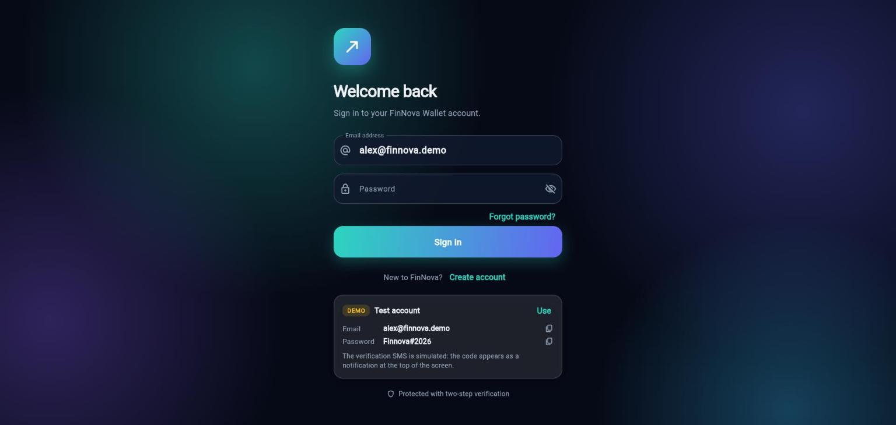
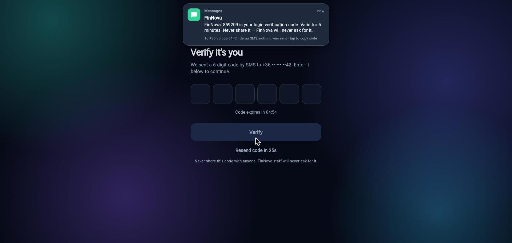
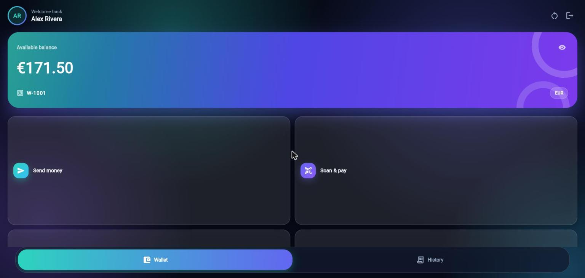
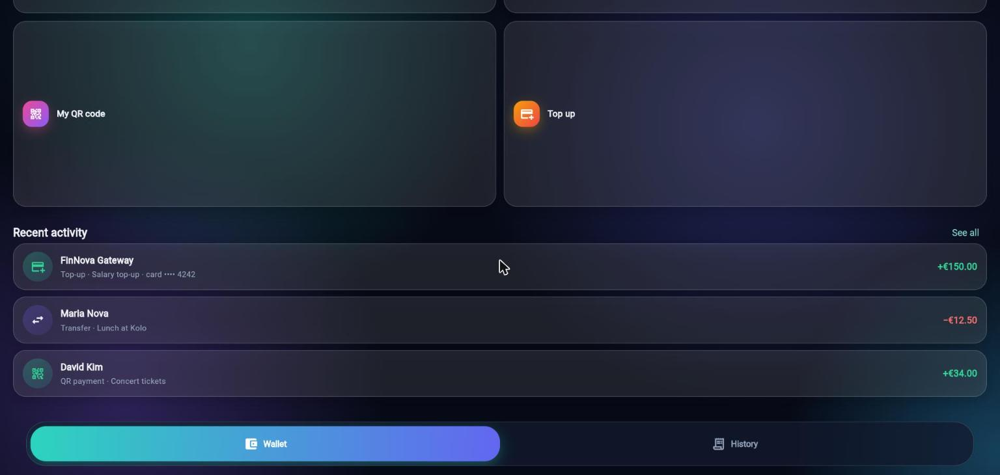
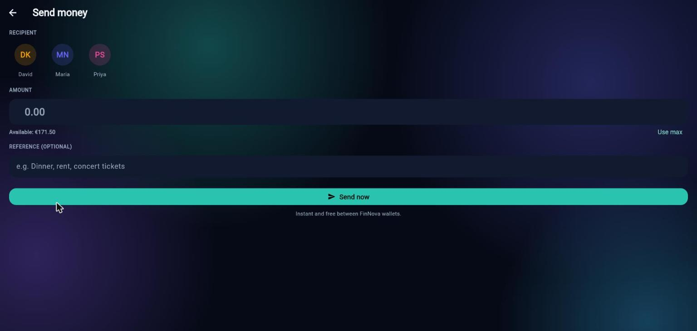
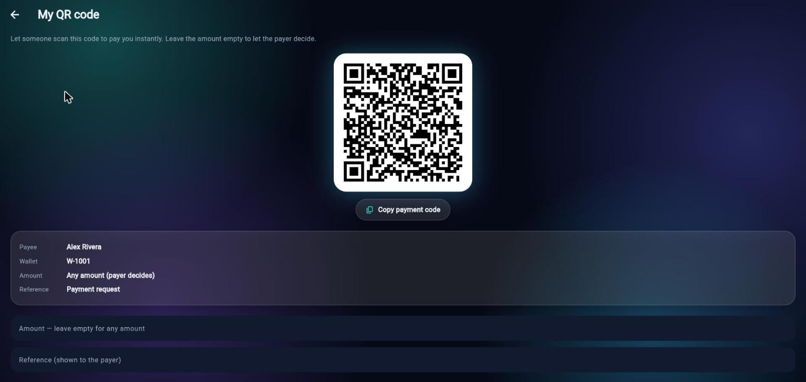
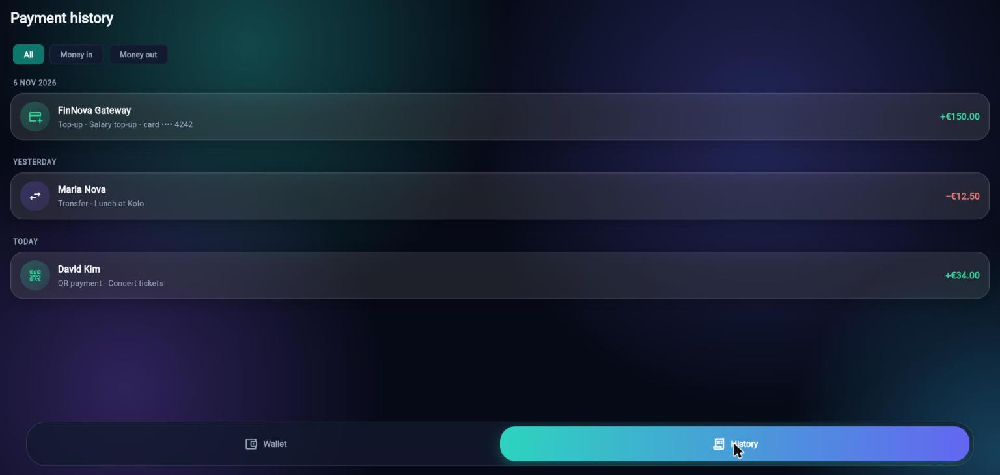
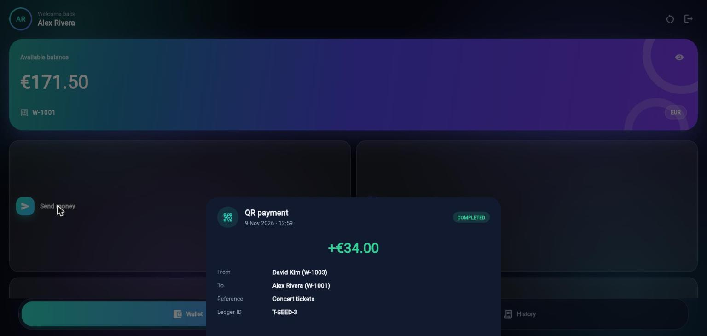

# FinNova Wallet (web build)

Live demo: **https://tngfranklin.github.io/finnova-web/**

FinNova Wallet is a cross-platform Flutter demo banking app for the FinNova Bank platform:
digital wallet, peer-to-peer transfers, QR payments and a payment history, protected by
email + password and a simulated SMS one-time code.

This repository only contains the compiled web build that GitHub Pages serves. The app is a
demo: all data is stored locally in the visitor's own browser, nothing is sent to a server,
and the SMS code is simulated on screen.

**Try it:** open the live demo and tap **Use** on the demo account card on the sign-in screen,
then enter the simulated code shown in the notification at the top of the screen.

## Screenshots

| Sign in | Two-step verification |
| --- | --- |
|  |  |

| Wallet | Quick actions and recent activity |
| --- | --- |
|  |  |

| Send money | My QR code |
| --- | --- |
|  |  |

| Payment history | Transaction details |
| --- | --- |
|  |  |

## Related

The FinNova Bank REST API (Node.js, PostgreSQL, Docker, deployed to Azure App Service with
GitHub Actions) is a separate project and is not called by this demo app.
